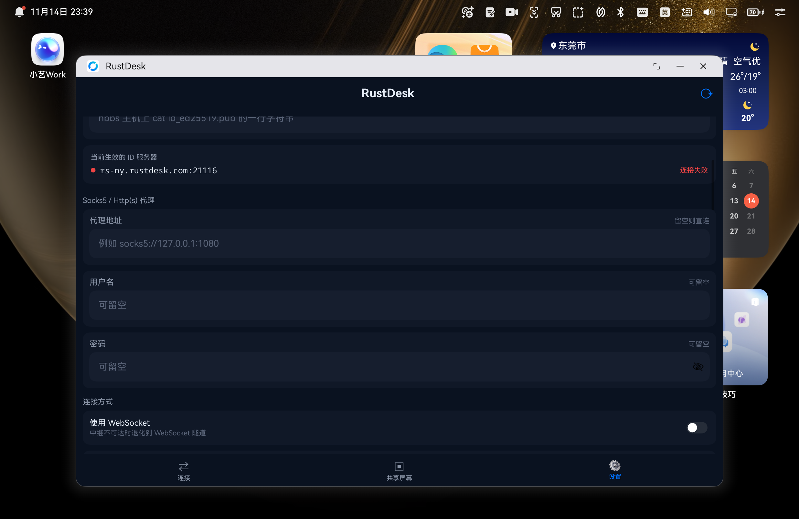

# RustDesk for HarmonyOS（鸿蒙）

把 [RustDesk](https://github.com/rustdesk/rustdesk) —— 一个用 Rust 写的开源远程桌面软件 ——
移植到 **HarmonyOS / OpenHarmony**，产出可在真机上侧载安装的 DevEco Studio 工程与 `.hap`。

- **移植对象**：`rustdesk/rustdesk` 发行 tag **1.5.3**（2026-11-09 发布）。本项目只跟正式发行 tag，不合 `master` 头。
- **移植方法**：以「新增文件 + 生成式 cfg 补丁」为主，协议/会话/加密/文件传输沿用上游源码；
  桌面 UI 不移植，改用原生 ArkTS 界面。C++ N-API 层负责音视频与系统能力。
- **当前状态**：`1.5.3` 已在 **HPR-W72 / 2in1 / OpenHarmony 7.0.0.109 / arm64-v8a** 真机上
  安装运行通过。2026-11-07 出过全功能测试报告，2026-11-16 完成 1.5.3 的升级冒烟。
- **软件名称**：显示为 **`RustDesk`**（`AppScope` 的 `app_name`），不加 `for HarmonyOS` 后缀。
- **版本号**：直接跟随上游发行版本，当前 `1.5.3`（`versionCode = 10503`），鸿蒙版不另立版本基数。
- **签名**：独立 bundle `cn.shaliuxin.remotedesk`，DevEco 调试签名，真机侧载；本项目不上架应用市场。

> 一句话定位：RustDesk 原本跑在桌面和手机上；本工程把它搬到鸿蒙，
> 复用上游几乎全部 Rust 业务代码，只重写平台后端和 ArkTS 界面，
> 通过 **ArkTS → C++ N-API → Rust 核心** 三层桥接，做到主控端 + 被控端都能用。



---

## 目录

- [功能与状态](#功能与状态)
- [架构（三层）](#架构三层)
- [目录结构](#目录结构)
- [环境要求](#环境要求)
- [构建与安装](#构建与安装)
- [签名说明](#签名说明)
- [版本规则](#版本规则)
- [已知限制](#已知限制)
- [许可与上游](#许可与上游)
- [移植必查：OHOS 平台判定](#移植必查ohos-平台判定)

---

## 功能与状态

下表如实区分「已验证」与「未验证」。功能项来自 2026-11-07 的全功能测试，
版本与 2026-11-16 的 1.5.3 升级冒烟，两者测试范围不同，已在说明列注明。

| 能力 | 状态 | 说明 |
| --- | --- | --- |
| Rust 双架构静态库 | ✅ 已验证 | `aarch64` 与 `x86_64` 两个 OHOS target 的 release `.a` 均在 1.5.3 重编通过 |
| CMake 链接 `libentry.so` | ✅ 已验证 | HAP 内含 `libs/arm64-v8a` 与 `libs/x86_64` 两套 `libentry.so`，均重新链接 |
| HAP 打包 + 调试签名 | ✅ 已验证 | `build-hap.sh hap` 调 hvigor `assembleHap`，`SignHap` 产出 `entry-default-signed.hap` |
| 真机安装运行 | ✅ 已验证 | `hdc install -r -d` 覆盖安装，核心初始化日志 `ohos: core initialized, abi 1` |
| 应用版本 / 核心版本 | ✅ 已验证 | 关于页两项均为 `1.5.3`，证明新内核确实生效 |
| 主控：连接 / 会话 / 文件传输 | ✅ 已验证 | 见 2026-11-07 全功能测试；1.5.3 只做升级冒烟，未重跑完整会话流程 |
| 被控：共享屏幕 / ID / 密码 | ✅ 已验证 | 同一测试报告，2in1 形态下本机 ID 与一次性密码刷新正常 |
| 设置页与配置持久化 | ✅ 已验证 | 服务器、代理、画质、打洞、隐私等项可读写；native 层配置跨重启保留 |
| ID 服务器三色状态 | ✅ 已验证 | 生效地址左侧圆点 + 右侧同色文字；1.5.3 上实测绿、红两态 |
| 出厂默认设置 | ✅ 已验证 | 全局 20 项 + 本地 7 项首次启动播种一次，升级后未重复播种 |
| 关于页 / 隐私政策页 | ✅ 已验证 | 版本、本机 ID、官网、项目地址、许可、隐私四章均已上屏 |
| 黄态「正在连接」 | ⚠️ 未主动触发 | 代码分支已覆盖，2026-11-01 曾做过三态闭环验证，1.5.3 未重测 |
| x86_64 真机运行 | ⚠️ 未验证 | 双 ABI 产物已校验，实测设备是 arm64-v8a |

> 出处（MLA）：「一、测试结果总览」，*RustDesk鸿蒙版-真机功能测试报告.md*，本地工作区 `C:/Users/mingh/WorkBuddy/2026-10-30-16-57-08/`，7 Nov. 2026；
> 「23:15–23:45 追加：1.5.3 真机安装冒烟 + 状态提示文字增强」，*2026-11-14.md*，同工作区，14 Nov. 2026.

---

## 架构（三层）

```
ArkTS (UIAbility + 原生 ArkUI 页面，import from 'libentry.so')
   │  N-API 事件 / 配置 / 会话调用
   ▼
C++ N-API 层（libentry.so）
   ├─ VideoRender：OH_VideoDecoder + XComponent Surface
   ├─ AudioEngine：OH_AudioRenderer / OH_AudioCapturer
   ├─ CaptureAdapter：AVScreenCapture → OH_VideoEncoder（被控端）
   ├─ InputInjection：OH_Input_RequestInjection（被控端，仅 2in1）
   └─ napi threadsafe function 事件推送
   │  C ABI（src/platform/ohos/ffi.rs 声明的同一份符号）
   ▼
librustdesk_core.a（cargo build --target aarch64-unknown-linux-ohos）
   └─ 上游协议 / 会话 / 加密 / 文件传输逻辑 + platform::ohos 平台后端
```

项目刻意**不追求纯 Rust**：ArkTS 拿不到音视频编解码绑定，这些必须在 C++ 侧做；
但协议、会话、加密、输入事件语义和文件传输全部留在 Rust，这是「复用上游」的实质。

上游代码改动分三层管理，原则是先新增、后配置、最后才少量真改：

| 层级 | 做法 | 是否入库 |
| --- | --- | --- |
| Tier 1 | OHOS 实现全部放在新增目录（`src/platform/ohos/`、`src/ohos/`、`libs/*/src/ohos/` 等） | 是 |
| Tier 2 | `apply-mobile-cfg.py` 构建时幂等施加 426 处 `target_env = "ohos"` cfg 补丁 | 否 |
| Tier 3 | 少量必须的上游适配（如 `initialize` 新增参数） | 是，见 `PATCH_INVENTORY.md` |

上游业务层复用率约 95%；全部工作量集中在 5 个平台后端和 ArkTS 界面重写。
完整约束与模块对应关系见 [`docs/ohos/ARCHITECTURE.md`](./docs/ohos/ARCHITECTURE.md)。

---

## 目录结构

```
rustdesk-hmos/
├─ src/platform/ohos/       # Rust 平台后端（会话、配置、原生导出）
├─ src/ohos/                # C ABI 导出层
├─ libs/scrap/src/ohos/     # 被控端屏幕采集
├─ libs/enigo/src/ohos/     # 被控端键鼠注入（仅 2in1）
├─ ohos-app/                # DevEco 工程（ArkTS UI + C++ N-API）
│  ├─ AppScope/             # 包名、应用名、图标
│  └─ entry/src/main/
│     ├─ ets/               # 页面：Home / SessionPage / FilePage / Settings / About 等
│     ├─ cpp/               # N-API 桥、CMakeLists、类型声明
│     └─ resources/         # 字符串、图标
├─ scripts/ohos/            # 构建、HAP 打包、上游同步脚本
│  ├─ build-core.sh         # Rust 双架构静态库
│  ├─ build-hap.sh          # hvigor 打包与签名
│  ├─ sync-upstream.sh      # 按发行 tag 同步上游
│  └─ apply-mobile-cfg.py   # Tier-2 生成式补丁
├─ docs/ohos/               # 架构说明与补丁清单
└─ .cargo/config.toml       # OHOS 交叉编译环境
```

---

## 环境要求

| 项 | 版本 / 说明 |
| --- | --- |
| DevEco Studio | 带 OpenHarmony SDK（API 12 起，实测 API 26）、native llvm、hvigor |
| Rust | 安装 `aarch64-unknown-linux-ohos` 与 `x86_64-unknown-linux-ohos` 两个 target |
| pkgconf | 用 PATH 里的 `pkgconf`，不要在 `.cargo/config.toml` 写死带版本号路径 |
| OHOS sysroot | `build-core.sh` 会自动补齐缺失的 `.pc` 文件与 vpx 头文件 |
| 设备 | HarmonyOS / OpenHarmony 真机或 2in1 设备，调试 Profile 需绑定设备 UDID |

---

## 构建与安装

```bash
# 1) 两个架构的 Rust release 静态库，必须都编，否则另一套 so 会是旧内核
OHOS_TARGET=aarch64-unknown-linux-ohos bash scripts/ohos/build-core.sh release
OHOS_TARGET=x86_64-unknown-linux-ohos  bash scripts/ohos/build-core.sh release

# 2) 打包签名 HAP（脚本负责 JAVA_HOME / DEVECO_SDK_HOME / PATH）
bash scripts/ohos/build-hap.sh hap

# 3) 产物
# entry/build/default/outputs/default/entry-default-signed.hap

# 4) 真机；-r -d 可在版本号不变时覆盖安装并保留沙箱数据
hdc install -r -d entry-default-signed.hap
hdc shell aa start -b cn.shaliuxin.remotedesk -a EntryAbility
```

发布包 `.app` 走 `bash scripts/ohos/build-hap.sh app`，使用 `release` 签名产品。
本项目已决定不上架应用市场，该产物仅保留备用。

上游同步只跟正式发行 tag：`bash scripts/ohos/sync-upstream.sh 1.5.3`。
本仓库的 `ohos/main` 有独立根提交，合并前需按架构文档处理 `git replace --graft` 与 shallow 历史。

---

## 签名说明

- 包名固定为 **`cn.shaliuxin.remotedesk`**，与显示名不一致不影响侧载。包名是华为 Profile 的绑定项，
  一旦上架就永久不可改，也不要复用其它鸿蒙项目的包名。
- `build-profile.json5` 里有两个产品：`default` 用调试签名，可侧载真机；`release` 用发布签名，
  只能上架、不能侧载。日常开发只用 `default`。
- 真实签名材料（`.p12` / `.cer` / `.p7b`）放在仓库外的 `C:\Users\mingh\OneDrive\RustDesk for HarmonyOS\`，
  **不入库**。调试 Profile 绑定本机设备 UDID，换设备需要重新生成。

---

## 版本规则

项目版本号直接跟随上游 RustDesk 发行版本，不另立基数：

| 项 | 规则 | 当前值 |
| --- | --- | --- |
| `versionName` | 等于上游 tag | `1.5.3` |
| `versionCode` | `主 × 10000 + 次 × 100 + 修订` | `10503` |
| 应用内展示 | `Version.ets` 的 `OHOS_APP_VERSION`，不加括号或平台后缀 | `1.5.3` |
| 核心版本 | 构建期生成的 `src/version.rs`，由 `native.version()` 读回 | `1.5.3` |

上游一发新版，需要同步修改 `app.json5`、两个 `oh-package.json5`、`Version.ets` 及相关注释。

---

## 已知限制

- **手机形态的被控端降级为仅观看**：平台没有键鼠注入接口，2in1 才开放 `OH_Input` 注入（需用户弹窗授权）。
  这条是平台红线，不通过系统漏洞绕过。
- **「恢复出厂默认」没有 UI 入口**：当前只能靠清除应用数据触发重新播种。用户未要求新增该入口。
- **黄色「正在连接」态未在 1.5.3 上主动触发**：状态机代码完整，历史版本做过三态闭环验证。
- **x86_64 真机未实测**：HAP 里两套库都在，真机测试只跑过 arm64-v8a。
- **受控输入框无法用自动化清空**：`uitest` 合成的退格对受控 `@State` 输入框不可靠，
  属于自动化局限，不是应用缺陷。

---

## 许可与上游

- 上游 RustDesk 采用 **AGPL-3.0**，本 fork 沿用同一许可，应用内「关于」页也标注 AGPL-3.0。
- 上游仓库：<https://github.com/rustdesk/rustdesk>
- 本移植仓库：<https://github.com/shaliuxin/rustdesk-hmos>
- 姊妹工程：<https://github.com/shaliuxin/gridcraft-hmos>、<https://github.com/shaliuxin/wordcraft-hmos>

---

## 移植必查：OHOS 平台判定

OHOS 的三元组仍报告 `target_os = "linux"`。上游里靠 `#[cfg(target_os = "linux")]` 分派的 Linux 专属逻辑
会在鸿蒙沙箱里被误用，而且编译链接全绿、只在运行时出怪错。本项目的实例是
`libs/scrap/build.rs` 在 OHOS 下仍走 pkg-config 探测，因此必须补齐 sysroot 的 `.pc` 文件与 vpx 头文件。

开工或每次上游升级后要做：① 搜索上游里按 `target_os = "linux"` 分派的代码并逐个判断；
② OHOS 分支只用 `#[cfg(target_env = "ohos")]`，Linux 分支加 `not(target_env = "ohos")`；
③ 构建脚本里的 `.pc` 补齐要幂等，不要只在本机手工补。

> 出处（MLA）：「§18. PhotoCraft 追加经验」，*craft-鸿蒙移植通用检查清单.md*，本地工作区 `C:/Users/mingh/WorkBuddy/2026-11-01-23-18-01/`，11 Nov. 2026；
> 「20.3 交叉编译环境：pkgconf 版本硬编码与 sysroot 的 .pc 缺口」，同文件，14 Nov. 2026.
